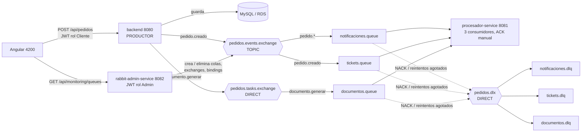

# Pedidos360 - Mensajería asíncrona con RabbitMQ (Evaluación 2)

Este documento describe lo que se agregó a Pedidos360 para la Evaluación Parcial 3 (encargo) y 4
(presentación) de DSY1107, cómo ejecutarlo y dónde está la evidencia para el informe.

La Evaluación 1 **no se reemplaza**: el backend de pedidos, el login con Entra ID, MySQL y el frontend
Angular siguen igual. La mensajería se agrega al lado y el pedido se guarda aunque RabbitMQ esté caído.

## 1. Arquitectura



| Componente | Carpeta | Rol |
|---|---|---|
| Backend de pedidos (existente) | `backend/` | Productor: publica el evento y el comando al guardar un pedido |
| Procesador | `procesador-service/` | Consumidores de notificaciones, tickets y documentos + topología (colas, DLQ, bindings) |
| Administrador RabbitMQ | `rabbit-admin-service/` | API REST para crear/eliminar colas, exchanges y bindings y ver el estado de las DLQ |
| Frontend | `frontend-pedidos360/` | Nueva vista `/mensajeria` con el estado de colas y alerta de DLQ |
| Infraestructura | `infra/rabbitmq/` | `docker-compose.yml` con el clúster de 2 nodos |

## 2. Topología

| Exchange | Tipo | Cola | Binding key | DLQ | Routing key al DLX |
|---|---|---|---|---|---|
| `pedidos.events.exchange` | **topic** | `notificaciones.queue` | `pedido.*` | `notificaciones.dlq` | `notificaciones.dead` |
| `pedidos.events.exchange` | **topic** | `tickets.queue` | `pedido.creado` | `tickets.dlq` | `tickets.dead` |
| `pedidos.tasks.exchange` | **direct** | `documentos.queue` | `documento.generar` | `documentos.dlq` | `documentos.dead` |
| `pedidos.dlx` | direct (DLX común) | las tres `*.dlq` | `<caso>.dead` | | |

- Todas las colas y exchanges son **durables**. Las DLQ tienen retención: `x-message-ttl` = 24 h y `x-max-length` = 10 000.
- Un mismo pedido genera 2 publicaciones: el evento `pedido.creado` (topic → notificaciones y tickets, 2 copias) y el comando `documento.generar` (direct → documentos).
- Los **nombres** viven solo en `application.yml` (`pedidos360.messaging.*`) de cada servicio; ninguna clase escribe un nombre literal.

## 3. Dónde se cumple cada indicador de la pauta (EP3)

| Indicador (peso) | Implementación |
|---|---|
| Nombres centralizados (12 %) | `pedidos360.messaging.*` en `backend/.../application.yml`, `procesador-service/.../application.yml` y `rabbit-admin-service/.../application.yml`, leídos con `@ConfigurationProperties` (`MessagingProperties`, `AdminProperties`). Los `@RabbitListener` usan `${pedidos360.messaging.queues.*.name}`. |
| Beans Queue/Exchange/Binding por caso de uso (13 %) | `procesador-service/.../config/`: `ExchangesConfig`, `NotificacionesTopologyConfig`, `TicketsTopologyConfig`, `DocumentosTopologyConfig` (+ `TopologySupport`). El productor declara sus exchanges en `backend/.../messaging/RabbitMessagingConfig`. |
| Configuración separada de la lógica (10 %) | Paquete `config/` solo con beans de mensajería; la lógica está en `*Service` (`NotificacionService`, `TicketService`, `DocumentoService`) que no conoce RabbitMQ. |
| Consumidores con `@RabbitListener` por dominio (15 %) | `procesador-service/.../notificaciones`, `tickets`, `documentos` (un paquete por dominio, un consumidor y un servicio cada uno). |
| ACK y manejo de errores (20 %) | `AckingMessageProcessor` (ver sección 4). `acknowledge-mode: manual`, `prefetch: 1`. |
| API REST del administrador (13 %) | `POST/GET/DELETE /api/queues`, `POST/DELETE /api/exchanges`, `POST/DELETE /api/bindings`, `GET /api/monitoring/queues` (sección 5). |
| Lógica encapsulada en servicio (10 %) | `RabbitAdminService`: los controladores solo llaman a sus métodos de alto nivel. |
| Validación de entrada (7 %) | DTO con Bean Validation (`QueueCreateRequest`, `ExchangeCreateRequest`, `BindingRequest`) + `GlobalExceptionHandler` con mensajes claros (400/404/409). |

Otros requisitos del encargo: el **JWT se valida** en backend y administrador (`SecurityConfig`: firma, issuer, audience, vigencia); los
errores no entregados van a **DLQ y se registran en logs** (`[TICKET] NACK -> DLQ msgId=... motivo=...`).

## 4. Manejo de ACK, reintentos y DLQ

Con `acknowledge-mode: manual` Spring **no** confirma ni rechaza solo: todo mensaje pasa por `AckingMessageProcessor`.

| Situación | Acción | Resultado |
|---|---|---|
| Procesado correctamente | `basicAck` | Sale de la cola |
| Error **permanente** (JSON inválido, dato inválido) | `basicNack(requeue=false)` de inmediato | DLX → DLQ, sin reintentos |
| Error **recuperable** | Reintento con backoff exponencial (1 s, 2 s; 3 intentos) | Si se recupera: ACK. Si no: `basicNack(requeue=false)` → DLQ |
| Mensaje duplicado (mismo `messageId`) | `basicAck` sin reprocesar | Idempotencia básica en memoria |
| Hilo interrumpido al apagar | `basicNack(requeue=true)` | No se pierde el mensaje |

Parámetros en `procesador-service/.../application.yml` (`pedidos360.messaging.retry`).

### Simulación de fallos (solo demostración)

Con `pedidos360.processor.failure-simulation=true` (por defecto en local) se escribe un marcador en la **descripción** del pedido:

| Marcador | Efecto |
|---|---|
| `#FAIL-TICKET` / `#FAIL-NOTIFICACION` / `#FAIL-DOCUMENTO` | Error recuperable que no se resuelve: 3 intentos y luego DLQ |
| `#INVALID-TICKET` / `#INVALID-NOTIFICACION` / `#INVALID-DOCUMENTO` | Error permanente: DLQ inmediata |
| `#FLAKY-TICKET` / `#FLAKY-NOTIFICACION` / `#FLAKY-DOCUMENTO` | Falla 2 veces y funciona la 3.ª (demuestra el reintento) |

En producción debe quedar en `false` (`FAILURE_SIMULATION=false`).

## 5. API del administrador (`rabbit-admin-service`, puerto 8082)

Lecturas: cualquier usuario autenticado. Escrituras: rol **Admin** en el token.

| Método y ruta | Descripción | Códigos |
|---|---|---|
| `POST /api/queues` | Crea cola. Cuerpo: `name` (obligatorio), `durable`, `autoDelete`, `deadLetterExchange`, `deadLetterRoutingKey`, `messageTtlMs`, `maxLength` | 201, 400, 409 |
| `GET /api/queues/{name}` | Mensajes y consumidores | 200, 404 |
| `DELETE /api/queues/{name}` | Elimina la cola | 204, 404 |
| `POST /api/exchanges` | Crea exchange. `name`, `type` (DIRECT, TOPIC, FANOUT, HEADERS), `durable`, `autoDelete` | 201, 400, 409 |
| `DELETE /api/exchanges/{name}` | Elimina el exchange | 204, 404 |
| `POST /api/bindings` | Enlaza `exchange` → `queue` con `routingKey` | 201, 400, 404 |
| `DELETE /api/bindings?exchange=&queue=&routingKey=` | Elimina el binding | 204, 400, 404 |
| `GET /api/monitoring/queues` | Cola principal + DLQ de cada caso de uso, con `alert` | 200 |

Reglas de validación: nombre obligatorio, 1-255 caracteres `[A-Za-z0-9._:-]`, sin el prefijo reservado `amq.`; TTL ≥ 0; `maxLength` > 0;
`deadLetterRoutingKey` exige `deadLetterExchange`; tipo de exchange acotado.

## 6. Ejecutarlo en local

Requisitos: Docker Desktop, JDK 17+, Node 20+.

```bash
# 1. Variables (el .env real está ignorado por git)
cp infra/rabbitmq/.env.example infra/rabbitmq/.env      # y reemplazar los valores

# 2. Clúster RabbitMQ (2 nodos) + MySQL de desarrollo
cd infra/rabbitmq && docker compose --profile local-db up -d && cd ../..

# 3. Empaquetar y levantar los 3 servicios con el perfil "local"
for s in backend procesador-service rabbit-admin-service; do (cd $s && ./mvnw -DskipTests package); done
scripts/run-local.sh start

# 4. Demostración completa (imprime la evidencia)
scripts/e2e-demo.sh | tee docs/evidencias/e2e-demo.txt

# 5. Detener
scripts/run-local.sh stop
```

- Interfaz de RabbitMQ: <http://localhost:15672> (nodo 1) y <http://localhost:15673> (nodo 2), con el usuario/clave del `.env`.
- **Perfil `local`**: acepta tokens HS256 firmados con `LOCAL_JWT_SECRET` (`scripts/dev-token.mjs Cliente|Admin`) para probar sin login
  de Entra ID. Fuera de ese perfil el JWT se valida contra Entra ID como en la Evaluación 1. **No usar el perfil `local` en AWS.**
- Variables de los servicios: `RABBITMQ_ADDRESSES`, `RABBITMQ_USERNAME`, `RABBITMQ_PASSWORD`, `RABBITMQ_VHOST`, además de las de la
  Evaluación 1 (`AZURE_TENANT_ID`, `AZURE_API_AUDIENCE`, `SPRING_DATASOURCE_*`).

## 7. Evidencia para el informe (antecedentes)

Todo en `docs/evidencias/`:

| Archivo | Qué demuestra |
|---|---|
| `capturas/01-overview-cluster.png` | RabbitMQ 4.2.9, **2 nodos** (`rabbit@rabbit1`, `rabbit@rabbit2`), 3 consumidores, 6 colas, 11 exchanges |
| `capturas/02-nodos.png` | Detalle de los nodos del clúster |
| `capturas/03-exchanges.png` | Exchanges `pedidos.events.exchange` (topic), `pedidos.tasks.exchange` (direct), `pedidos.dlx` (direct) |
| `capturas/04-colas.png` | 3 colas principales + 3 DLQ, con features DLX/DLK/TTL/Lim y 1 mensaje en cada DLQ |
| `capturas/05-detalle-tickets-queue.png` | Cola principal: argumentos de DLX, bindings y consumidor |
| `capturas/06-detalle-tickets-dlq.png` | DLQ: retención (TTL, max-length) y mensaje muerto |
| `capturas/07-exchange-topic-bindings.png` | Bindings del exchange topic (`pedido.*`, `pedido.creado`) |
| `capturas/08-exchange-dlx-bindings.png` | Bindings del DLX hacia cada DLQ |
| `capturas/09-canales-consumidores.png` | Canales y consumidores |
| `cluster-status.txt` | `docker compose ps`, `docker ps` y `rabbitmqctl cluster_status` |
| `e2e-demo.txt` | Secuencia completa: topología, 401/403, flujo feliz, reintento, DLQ, administración y validaciones |
| `logs/*.log` | Logs reales de los tres servicios (`[PUBLISH]`, `ACK`, `intento n/3`, `NACK -> DLQ`) |
| `logs/procesador-service.ANTES-del-fix-conversion.log` | El error de conversión encontrado y corregido (sección 8) |

## 8. Hallazgos durante la construcción

1. **Conversión de mensajes y paquetes no confiables.** Exponer el conversor JSON como bean hacía que el contenedor del listener
   intentara reconstruir la clase del productor (`com.pedidos360.backend...`) desde el header `__TypeId__` y fallara. Peor: en modo
   `manual`, un fallo de conversión **deja el mensaje sin confirmar** y bloquea la cola (con `prefetch: 1`). Solución: el procesador usa un
   conversor interno con tipo destino explícito y trata el JSON inválido como error permanente → DLQ. Hay una prueba unitaria para ese caso.
2. **Healthcheck de RabbitMQ.** `rabbitmq-diagnostics ping` arranca una VM Erlang completa y en este equipo tardaba ~11 s (timeout de 10 s),
   dejando los contenedores en `unhealthy`. Se reemplazó por un chequeo TCP al puerto AMQP.
3. **Bloqueo al recrear el clúster.** Con `depends_on: condition: service_healthy`, `rabbit1` esperaba a `rabbit2` (mayoría de metadata en un
   clúster de 2 nodos) y `rabbit2` esperaba a `rabbit1`. Se dejó solo orden de arranque. Verificado con `docker compose down` + `up`.
4. **2 nodos y tipo de cola.** Las colas son *classic* y viven en un nodo; el clúster de 2 nodos cumple lo pedido pero no replica las colas.
   Replicar de verdad pide *quorum queues* y 3 nodos (con 2, perder uno detiene la cola). Se deja como mejora.

## 9. Checklist de la presentación (EP4)

| Requisito | Estado |
|---|---|
| Dos nodos RabbitMQ en clúster | **Hecho en la nube** (`evidencias/aws/capturas/aws-01-*.png`) y en local (`cluster-status.txt`) |
| Tres colas con sus DLQ funcionando | **Hecho en la nube** (`evidencias/aws/nube-flujo-colas.txt`, `aws-02-colas-y-dlq.png`) y en local (`e2e-demo.txt`) |
| Exchanges direct y topic | **Hecho en la nube** (`aws-03-exchanges-direct-topic.png`) |
| `docker-compose` levantando RabbitMQ en la nube | **Hecho**: `infra/aws/docker-compose.aws.yml` corriendo en la EC2 (`evidencias/aws/nube-logs-procesador.txt`) |
| Backend y frontend desplegados | **Hecho**: backend en la EC2 + RDS; frontend en S3 privado servido por el API Gateway (`aws-05-frontend-publicado.png`) |
| API Manager valida JWT, rechaza inválidas | **Hecho**: API Gateway con autorizador JWT de Entra ID (`evidencias/aws/aws-recursos.txt`); sin token responde 401. **Falta probar con un token real** (login en el frontend) |
| Frontend consume vía API Manager | Publicado y apuntando al gateway. **Falta registrar la redirect URI en Entra ID y probar con login real** |
| Administrador por el API Gateway | Servicio corriendo y rutas creadas; **el puerto 8082 sigue cerrado** (ver `infra/aws/README.md`). No es requisito de la presentación |
| Tenant IDaaS, usuarios y login OAuth2/OIDC | Evaluación 1: tenant, 2 usuarios y apps `Pedidos360-API`/`Pedidos360-Web` verificados en el portal |

Pendientes que dependen de tu cuenta/entorno y no se pueden hacer desde el código:

- Crear (si no existe) el **app role `Admin`** en el registro `Pedidos360-API` de Entra ID y asignarlo a un usuario.
- Desplegar en AWS (compose de RabbitMQ y los dos servicios) y abrir en el Security Group solo lo necesario (5672 entre servicios; 15672 solo a tu IP).
- Tomar la captura de la vista `/mensajeria` del frontend con un login real (requiere sesión de Entra ID).
- Usar credenciales fuertes en `.env` en la nube; las de `guest/guest` son solo para pruebas.
